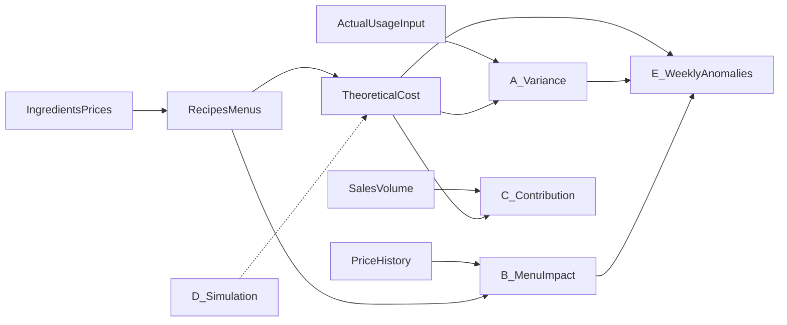

# MarginMap 차별화 기능별 사용자 흐름

| 항목 | 내용 |
|------|------|
| 관련 문서 | [01 PRD](01-product-requirements.md), [02 MVP](02-mvp-scope.md), [07 공식](07-formulas.md) |
| 제외 유지 | 수율 계산, 조리시간·인건비 분석 |

공통 전제: 실제 소비량·판매량이 없으면 **추정·임의 생성하지 않는다**. 빈 상태와 필요 입력을 안내한다.

---

## DF-A. 이론상 원가와 실제 원가의 차이 추적 (1순위)

### 목표

레시피 기준 이론 소비량과 사용자가 입력한 실제 소비량(또는 실제 사용 원가)을 비교한다.

### 사전 조건

- 식재료·메뉴 레시피 등록
- 이론 소비량 산출에 필요한 기간별 **메뉴 판매량** 또는 사용자가 지정한 이론 기준
- **실제** 사용량 또는 실제 사용 원가 입력 (없으면 결과 화면 비활성/빈 상태)

### 흐름

1. 사용자가 분석 기간(예: 주간)을 선택한다.
2. 시스템이 기간 판매량 × 레시피 투입량으로 **이론상 소비량**을 계산한다. 판매량이 없으면 이론량을 만들지 않거나, “판매량 입력 필요”를 표시한다.
3. 사용자가 식재료별 **실제 사용량** 또는 **실제 사용 원가**를 입력·저장한다.
4. 시스템이 차이 수량·차이 금액·차이율을 계산해 목록·상세에 표시한다.
5. 동일 매장의 기간별 차이를 추이 차트로 확인한다 (입력이 있는 기간만).

### 빈 상태 규칙

| 상태 | UI 동작 |
|------|---------|
| 레시피 없음 | 안내 후 레시피 등록으로 유도 |
| 판매량 없음 (이론 산출 불가) | 이론·차이 미계산. 판매량 또는 이론 기준 입력 유도 |
| 실제 사용 없음 | 차이 미표시. 실제 입력 유도 |
| 일부 식재료만 실제 입력 | 입력된 식재료만 차이 표시. 나머지는 “미입력” |

### 주요 화면

- 기간 선택 + 실제 사용 입력 폼
- 식재료별 이론 / 실제 / 차이 / 차이율 테이블
- 기간 추이

---

## DF-B. 식재료 가격 변동의 메뉴별 영향 분석 (1순위)

### 목표

식재료 구매 단가 변경이 해당 재료를 쓰는 모든 메뉴의 원가·공헌이익에 미치는 영향을 보여 준다. 변경 전후를 이력으로 보존한다.

### 사전 조건

- 식재료와 이를 참조하는 메뉴/프렙 레시피
- 단가 변경 이벤트 (수동 수정)

### 흐름

1. 사용자가 식재료 단가(또는 구매가·규격)를 변경한다.
2. 시스템이 `IngredientPriceHistory`에 이전/이후 단가·시각을 append하고 현재 단가를 갱신한다.
3. 해당 식재료(및 이를 포함한 프렙)를 쓰는 메뉴 목록을 산출한다.
4. 변경 전 단가 vs 변경 후 단가로 메뉴별 식재료원가·공헌이익·공헌이익률을 재계산·비교한다.
5. 원가 증가액·증가율·공헌이익 감소가 큰 메뉴를 상단에 정렬한다.
6. 이력 화면에서 과거 변경 건을 골라 동일 비교를 다시 볼 수 있다.

### 빈 상태 규칙

| 상태 | UI 동작 |
|------|---------|
| 이력 없음 | “아직 가격 변경 없음” |
| 영향 메뉴 없음 | “이 재료를 쓰는 메뉴가 없음” |

### 주요 화면

- 식재료 가격 편집 + 확인
- 가격 변경 이력 목록
- 영향 메뉴 비교 (전/후, Δ원가, Δ공헌이익)

---

## DF-C. 판매량과 공헌이익 통합 분석 (2순위)

### 목표

메뉴별 판매량과 단위 공헌이익을 결합해 총 공헌이익 기여도를 본다. 잘 팔리지만 남는 게 적은 메뉴 / 적게 팔리지만 단위 마진이 큰 메뉴를 식별한다.

### 사전 조건

- 메뉴 이론 원가·공헌이익 산출 가능
- 기간별 **실제 판매량** 입력 (추측 금지). MVP 이후 CSV 가져오기 가능

### 흐름

1. 사용자가 기간을 선택하고 메뉴별 판매량을 수동 입력(또는 CSV import)한다.
2. 시스템이 메뉴당 공헌이익 × 판매량 = **총 공헌이익**을 계산한다.
3. 판매량 vs 단위 공헌이익(또는 총 공헌이익)을 함께 비교하는 목록·산점/사분면 뷰를 제공한다.
4. “고판매·저공헌” / “저판매·고공헌” 필터 또는 정렬을 제공한다.

### 빈 상태 규칙

| 상태 | UI 동작 |
|------|---------|
| 판매량 없음 | 분석 미생성. 입력 유도 |
| 일부 메뉴만 판매량 있음 | 해당 메뉴만 집계. 나머지 제외 명시 |

### 주요 화면

- 판매량 입력 / CSV
- 기여도 테이블·비교 뷰

---

## DF-D. 판매 가격 및 목표 수익률 시뮬레이션 (2순위 고도화 / 기본은 Core)

### 목표

운영 데이터를 바꾸지 않고 판매가·재료가·채널 수수료 변경 전후를 비교하고, 목표 공헌이익률에 필요한 판매가를 구한다.

### 사전 조건

- 기준이 되는 메뉴·채널·원가 스냅샷 (현재 운영 값 읽기 전용)

### 흐름 (기본 — MVP Core)

1. 사용자가 시뮬레이션 화면에 진입한다 (운영 저장과 분리된 워크스페이스).
2. 판매가 / 특정 재료 단가 / 수수료율을 임시로 변경한다.
3. 전후 식재료원가·채널비용·공헌이익·공헌이익률을 즉시 재계산한다.
4. “적용(운영 반영)”은 별도 명시적 액션. 기본 닫기·새로고침 시 시나리오는 버려진다.

### 흐름 (고도화 — Diff-2)

1. 여러 시나리오를 이름 붙여 초안 저장 (`SimulationScenario`, 운영 테이블과 분리).
2. 채널별 수수료를 동시에 비교한다.
3. 목표 공헌이익률을 입력하면 필요 판매가를 계산한다 ([07-formulas.md](07-formulas.md)).
4. 시나리오 간 나란히 비교한다.

### 분리 규칙

- 시뮬레이션 중 값은 Ingredient / MenuItem 운영 레코드를 덮어쓰지 않는다.
- 운영 반영 시 가격 이력(DF-B) 규칙을 따른다.

---

## DF-E. 주간 원가 및 수익성 이상 징후 감지 (1순위)

### 목표

주간 데이터를 비교해 원가 상승·공헌이익 하락·이론–실제 차이 확대·가격 충격 영향 메뉴를 규칙으로 감지하고 대시보드에 “확인 필요”로 표시한다.

### 사전 조건

- 최소 N주(기본 제안: **연속 2주**)의 비교 가능한 스냅샷 또는 재계산 가능한 원천 데이터
- AI 미사용. 임계값은 설정 가능 (기본값 문서화)

### 제안 기본 규칙 (확정값은 구현 전 설정 화면/상수로 고정)

| 규칙 ID | 조건 예시 | 알림 |
|---------|-----------|------|
| E1 | 메뉴 식재료원가 WoW +5% 이상 | 원가 상승 |
| E2 | 메뉴 공헌이익률 WoW −3pp 이상 | 수익성 하락 |
| E3 | DF-A 차이율 WoW +X%p 이상 (실데이터 있는 경우만) | 차이 확대 |
| E4 | 해당 주에 DF-B로 단가 상승한 재료를 쓰는 메뉴 | 가격 충격 영향 |

### 흐름

1. 주간 배치 또는 사용자 “이번 주 점검” 실행 시 현재 주·이전 주 지표를 산출한다.
2. 데이터 충분성 검사를 통과하지 못하면 **알림을 생성하지 않고** “데이터 부족”만 표시한다.
3. 통과 시 규칙 E1–E4를 평가해 `Alert`를 만든다.
4. 대시보드에 확인 필요 항목 요약과 상세 링크를 보여 준다.
5. 사용자가 확인(acknowledge)할 수 있다.

### 빈 상태 규칙

| 상태 | UI 동작 |
|------|---------|
| 주 수 부족 | 분석 미생성 |
| 규칙 해당 없음 | “이상 징후 없음” (허위 데이터 아님) |
| A 실데이터 없음 | E3 스킵. 다른 규칙은 가능하면 평가 |

### 주요 화면

- 대시보드 “확인 필요” 카드
- 주간 변화 요약
- 알림 상세 → A/B/메뉴로 이동

---

## 우선순위와 구현 의존성

| 순서 | 기능 | 의존 |
|------|------|------|
| 기반 | 이론 원가·기본 시뮬 | 재료·레시피·채널 |
| 1 | DF-B | 가격 이력 |
| 1 | DF-A | 판매량(또는 이론 기준) + 실제 사용 입력 |
| 1 | DF-E | 주간 지표 + (선택) A/B 결과 |
| 2 | DF-C | 판매량 + 단위 공헌이익 |
| 2 | DF-D 고도화 | 기본 시뮬 |
