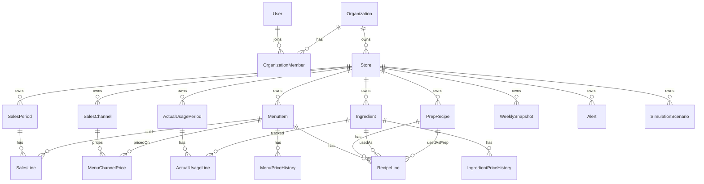

# MarginMap 데이터 모델 및 ERD

| 항목 | 내용 |
|------|------|
| 관련 문서 | [01 PRD](01-product-requirements.md), [06 API](06-api-spec.md), [07 공식](07-formulas.md) |
| Stage 1 확정본 | **[11-stage1-data-design.md](11-stage1-data-design.md)** (충돌 시 Stage 1 우선) |
| ORM | Prisma + PostgreSQL |
| 금지 필드 | 손질 수율(yield loss), 조리시간, 인건비 |

> Stage 0 개요 문서다. CostBasisSnapshot·AnalysisRun·수수료 중복 방지·공헌이익/순이익 구분 등은 Stage 1 문서를 따른다.

---

## 1. 설계 원칙

1. **Store 스코프:** 업무 엔티티는 `storeId`로 격리한다.
2. **확장성:** `Organization` 1 — N `Store`. MVP는 Organization당 Store **1개만** 생성·사용. 다매장 UI 없음.
3. **이력 보존:** 식재료·메뉴 가격은 덮어쓰기만 하지 않고 history 테이블에 append.
4. **추정 금지:** 이론–실제 차이·판매 분석·이상 징후는 원천 입력이 있을 때만 의미 있는 행을 만든다.
5. **시뮬레이션 분리:** 기본은 비영속. 저장 시 `SimulationScenario`는 운영 테이블과 분리.
6. **프렙:** `PrepRecipe` + `yieldQty`만. 수율(손실률) 컬럼 없음.

---

## 2. ERD

MVP에서 Organization–Store는 논리적으로 1:1처럼 사용한다. ERD상 Store는 Organization에 N 가능하도록 둔다.

---

## 3. 엔티티 정의

### 3.1 계정·테넌시

#### User

| 필드 | 타입 | 설명 |
|------|------|------|
| id | UUID | PK |
| email | String | Unique |
| passwordHash | String | 또는 외부 Auth 연동 시 nullable |
| createdAt | DateTime | |

#### Organization

| 필드 | 타입 | 설명 |
|------|------|------|
| id | UUID | PK |
| name | String | |
| createdAt | DateTime | |

#### OrganizationMember

| 필드 | 타입 | 설명 |
|------|------|------|
| id | UUID | PK |
| organizationId | UUID | FK |
| userId | UUID | FK |
| role | Enum | OWNER (MVP는 OWNER만) |

#### Store

| 필드 | 타입 | 설명 |
|------|------|------|
| id | UUID | PK |
| organizationId | UUID | FK |
| name | String | |
| currency | String | 기본 `KRW` |
| createdAt | DateTime | |

**MVP 제약 (애플리케이션):** Organization 생성 시 Store 1개만 허용. 추가 Store API는 거부하거나 미구현.

---

### 3.2 식재료·가격

#### Ingredient

| 필드 | 타입 | 설명 |
|------|------|------|
| id | UUID | PK |
| storeId | UUID | FK |
| name | String | |
| baseUnit | Enum/String | g, ml, ea 등 |
| purchaseQty | Decimal | 구매 규격 수량 (baseUnit 환산 기준) |
| purchasePrice | Decimal | 구매 금액 (KRW) |
| taxType | Enum | TAXABLE / EXEMPT |
| currentUnitCost | Decimal | purchasePrice / purchaseQty (환산 후) |
| notes | String? | |
| updatedAt | DateTime | |

**금지:** `yieldRate`, `trimLoss`, `laborMinutes` 등.

#### IngredientPriceHistory

| 필드 | 타입 | 설명 |
|------|------|------|
| id | UUID | PK |
| ingredientId | UUID | FK |
| previousUnitCost | Decimal | |
| newUnitCost | Decimal | |
| previousPurchasePrice | Decimal? | |
| newPurchasePrice | Decimal? | |
| previousPurchaseQty | Decimal? | |
| newPurchaseQty | Decimal? | |
| effectiveAt | DateTime | |
| source | Enum | MANUAL / IMPORT / FUTURE_AI_ASSIST |
| createdByUserId | UUID? | |

---

### 3.3 메뉴·프렙·레시피

#### PrepRecipe

| 필드 | 타입 | 설명 |
|------|------|------|
| id | UUID | PK |
| storeId | UUID | FK |
| name | String | |
| yieldQty | Decimal | 산출량 (baseUnit) |
| yieldUnit | String | baseUnit과 동일 체계 |
| updatedAt | DateTime | |

산출량으로 프렙 단위원가를 나눈다. 손질 전/후 수율 비율 필드는 두지 않는다.

#### MenuItem

| 필드 | 타입 | 설명 |
|------|------|------|
| id | UUID | PK |
| storeId | UUID | FK |
| name | String | |
| sellingPrice | Decimal | 기본 판매가 (채널별 오버라이드 가능) |
| vatInclusive | Boolean | 판매가 VAT 포함 여부 표기 |
| isActive | Boolean | |
| updatedAt | DateTime | |

#### RecipeLine

| 필드 | 타입 | 설명 |
|------|------|------|
| id | UUID | PK |
| menuItemId | UUID? | 메뉴 소유 시 |
| prepRecipeId | UUID? | 프렙 소유 시 |
| ingredientId | UUID? | 식재료 라인 |
| componentPrepId | UUID? | 하위 프렙 라인 |
| qty | Decimal | 투입량 |
| unit | String | |

제약: (`menuItemId` XOR 소유 prep) 하나, (`ingredientId` XOR `componentPrepId`) 하나. 순환 참조는 애플리케이션에서 금지.

#### MenuPriceHistory

| 필드 | 타입 | 설명 |
|------|------|------|
| id | UUID | PK |
| menuItemId | UUID | FK |
| previousPrice | Decimal | |
| newPrice | Decimal | |
| effectiveAt | DateTime | |
| source | Enum | MANUAL / SIMULATION_APPLY |

#### SalesChannel

| 필드 | 타입 | 설명 |
|------|------|------|
| id | UUID | PK |
| storeId | UUID | FK |
| name | String | 홀, 배달A 등 |
| channelFeeRate | Decimal | 0–1 |
| paymentFeeRate | Decimal | 0–1 |
| deliveryFeeFixed | Decimal | 고정 배달비 (메뉴당 또는 건당 정의는 구현 시 문서화) |
| deliveryFeeRate | Decimal | 판매가 비율 배달비 |
| isDefault | Boolean | |

#### MenuChannelPrice (선택, MVP에 포함 권장)

| 필드 | 타입 | 설명 |
|------|------|------|
| id | UUID | PK |
| menuItemId | UUID | FK |
| salesChannelId | UUID | FK |
| sellingPrice | Decimal | 채널별 판매가 |

---

### 3.4 차별화 A·C 입력

#### ActualUsagePeriod

| 필드 | 타입 | 설명 |
|------|------|------|
| id | UUID | PK |
| storeId | UUID | FK |
| periodStart | Date | |
| periodEnd | Date | |
| note | String? | |

#### ActualUsageLine

| 필드 | 타입 | 설명 |
|------|------|------|
| id | UUID | PK |
| periodId | UUID | FK |
| ingredientId | UUID | FK |
| actualQty | Decimal? | 실제 사용량 |
| actualCost | Decimal? | 실제 사용 원가 (금액 직접 입력 시) |
| unit | String? | |

`actualQty` 또는 `actualCost` 중 최소 하나 필요. 둘 다 없으면 라인 저장 거부.

#### SalesPeriod / SalesLine

| 엔티티 | 주요 필드 |
|--------|-----------|
| SalesPeriod | storeId, periodStart, periodEnd |
| SalesLine | periodId, menuItemId, qty, salesChannelId? |

판매량 추측 저장 금지. 사용자 입력 또는 CSV import만.

---

### 3.5 주간 스냅샷·알림 (E)

#### WeeklySnapshot

| 필드 | 타입 | 설명 |
|------|------|------|
| id | UUID | PK |
| storeId | UUID | FK |
| weekStart | Date | ISO 주 시작 |
| payload | JSON | 메뉴·재료 지표 요약 (결정론적 산출물 캐시) |
| dataSufficient | Boolean | false면 알림 생성 안 함 |
| createdAt | DateTime | |

#### Alert

| 필드 | 타입 | 설명 |
|------|------|------|
| id | UUID | PK |
| storeId | UUID | FK |
| weekStart | Date | |
| ruleId | String | E1, E2, E3, E4 |
| severity | Enum | INFO / WARN |
| title | String | |
| body | String | |
| entityType | String? | MENU / INGREDIENT |
| entityId | UUID? | |
| acknowledgedAt | DateTime? | |

---

### 3.6 시뮬레이션 (D)

#### SimulationScenario (고도화 시)

| 필드 | 타입 | 설명 |
|------|------|------|
| id | UUID | PK |
| storeId | UUID | FK |
| name | String | |
| draft | JSON | 임시 판매가·단가·수수료 오버라이드 |
| createdAt | DateTime | |
| updatedAt | DateTime | |

운영 Ingredient/MenuItem 행을 직접 수정하지 않는다.

---

## 4. 인덱스·무결성 (요약)

- `(storeId, name)` unique 권장: Ingredient, MenuItem, PrepRecipe, SalesChannel
- RecipeLine 순환 검사 (앱 레이어)
- ActualUsageLine: qty/cost 중 하나 필수
- MVP: `count(Store where organizationId)` ≤ 1 강제

---

## 5. 다매장 확장 시 (비-MVP)

- Store 추가 API·전환 UI
- OrganizationMember 역할 (MANAGER 등)
- 크로스 스토어 리포트 (별도 승인)

스키마에 `storeId`가 이미 있으므로 마이그레이션 부담을 줄인다.

---

## 6. 제외 확인 체크리스트

구현·리뷰 시 아래가 스키마에 **없어야** 한다.

- [ ] 손질 수율 / trim loss / yield rate (프렙 yieldQty는 산출량이며 수율 아님)
- [ ] 조리시간 / prep minutes
- [ ] 인건비 / labor cost / wage
