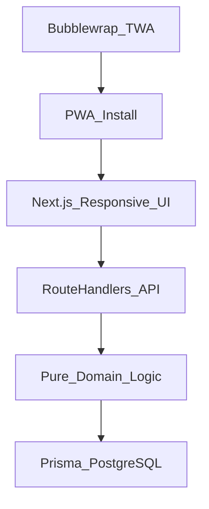

# MarginMap 웹·PWA·Android 아키텍처

| 항목 | 내용 |
|------|------|
| 관련 문서 | [01 PRD](01-product-requirements.md), [06 API](06-api-spec.md), [10 구현 계획](10-implementation-plan.md) |
| Android 전략 | Bubblewrap + Trusted Web Activity (TWA) |
| 제외 | iOS, 초기 네이티브 Android |

---

## 1. 목표

- Next.js 반응형 웹을 1차 제품으로 출시
- PWA 설치로 모바일 홈 화면 사용
- 동일 API·도메인 로직으로 Android를 Play에 배포 (웹 재사용)
- 네이티브 앱은 **실제 요구가 확인된 뒤에만** 검토

---

## 2. 논리 아키텍처



| 계층 | 책임 | 금지 |
|------|------|------|
| UI (App Router) | 화면, 폼, 빈 상태 | 원가 공식 복제(가능하면 API/domain 결과 사용) |
| API `/api/v1` | 인증, Zod, Store 스코프, Prisma I/O | 추정 데이터 생성 |
| `domain/` | 원가·공헌이익·A/B/C/D/E 규칙 | React, Prisma, fetch 의존 |
| DB | 영속 | 수율·인건비 컬럼 |

공유 계산은 반드시 `domain/`에 두고 Vitest로 검증한다. 웹·TWA는 같은 백엔드를 호출하므로 플랫폼별 공식 분기 없음.

---

## 3. 웹 (Next.js)

### 3.1 스택

- Next.js App Router, TypeScript, Tailwind CSS
- PostgreSQL, Prisma ORM, Zod, Vitest
- Docker Compose: 로컬 Postgres

### 3.2 권장 디렉터리 (구현 시)

```
app/                 # 라우트·UI·route handlers
domain/              # 순수 계산·규칙
lib/prisma.ts
prisma/schema.prisma
public/manifest.webmanifest
public/sw.js         # 또는 next-pwa 등 선택
docker-compose.yml
```

### 3.3 배포

- HTTPS 필수 (PWA·TWA Digital Asset Links)
- 환경 변수: `DATABASE_URL`, Auth 시크릿 등

---

## 4. PWA

### 4.1 요구

| 항목 | 내용 |
|------|------|
| Manifest | name, short_name, start_url, display=standalone, icons (192/512) |
| Service Worker | 앱 셸 캐시, 네트워크 우선 API |
| 오프라인 | MVP는 셸·정적 자산 수준. 원가 데이터 완전 오프라인 동기화는 비범위 |
| Installability | Chromium 기준 설치 가능 조건 충족 |

### 4.2 검증

- Chrome DevTools Application → Manifest / SW
- 모바일 Chrome에서 “홈 화면에 추가”
- Lighthouse PWA 체크 (참고)

---

## 5. Android (Bubblewrap TWA)

### 5.1 선택 이유

- 웹·PWA와 **단일 코드베이스**
- Google 권장 경로: Bubblewrap로 AAB 생성, Trusted Web Activity로 풀스크린
- Capacitor/네이티브는 푸시·파일 등 네이티브 플러그인이 필수일 때 재검토

### 5.2 패키징 흐름

1. 프로덕션 HTTPS에 PWA 배포 (유효한 manifest)
2. `bubblewrap init --manifest=https://<domain>/manifest.webmanifest`
3. `bubblewrap build` → `app-release-bundle.aab`
4. Play Console에 AAB 업로드 (Play App Signing 권장)
5. 사이트에 `/.well-known/assetlinks.json` 배포  
   - `package_name` + **업로드 키 및 Play 앱 서명 키** SHA-256
6. Digital Asset Links 검증 실패 시 Custom Tab(주소창)으로 폴백됨 → 서명 지문 수정

### 5.3 Play 출시 체크리스트

| 항목 | 내용 |
|------|------|
| Google Play 개발자 계정 | 등록·비용은 Google 정책에 따름 (계정 생성 시 확인) |
| 앱 서명 | Play App Signing |
| 테스트 트랙 | 내부 테스트 → 비공개/공개 테스트 → 프로덕션 |
| 스토어 등록 정보 | 제목, 짧은/긴 설명, 스크린샷, 아이콘, 기능 그래픽 |
| 콘텐츠 등급 | IARC 설문 |
| 개인정보처리방침 | URL 필수 (계정·매장 데이터) |
| 타깃 API | Play 요구 수준 준수 |
| TWA 특화 | assetlinks.json 200 OK, 리다이렉트 없이 제공 |

### 5.4 iOS

초기 출시 범위에서 **제외**. 요구 확인 후 별도 승인.

### 5.5 네이티브 재검토 트리거

다음이 제품 필수가 되면 Capacitor 또는 네이티브 검토:

- 백그라운드 푸시가 PWA로 불충분
- 카메라·파일 접근이 웹 권한으로 부족
- Play 정책상 TWA로 충족 불가한 요구

---

## 6. 보안·테넌시

- 모든 API: 세션 사용자 → OrganizationMember → Store 소유권 검증
- MVP: Store 1개 제약
- 시뮬레이션 apply·가격 변경은 감사 가능한 history 기록
- AI 보조(후순위): draft만 반환, 저장은 사용자 확인 후 기존 API

---

## 7. 로컬 개발

```text
docker compose up -d   # PostgreSQL
pnpm/npm run dev       # Next.js
```

테스트 DB는 Vitest 통합 테스트용 별도 URL 권장.

---

## 8. 아키텍처 결정 요약

| 결정 | 선택 |
|------|------|
| 모바일 1차 | 반응형 + PWA |
| Android | Bubblewrap TWA |
| 비즈니스 로직 | `domain/` 공유 |
| 다매장 | 스키마만 준비, UI 없음 |
| 수율·인건비 | 전 계층 미구현 |
