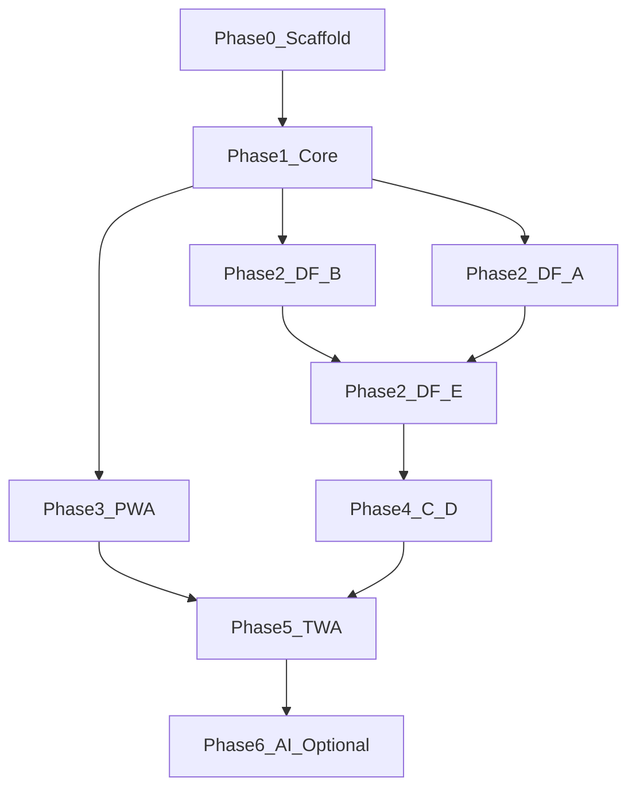

# MarginMap 단계별 구현 계획

| 항목 | 내용 |
|------|------|
| 전제 | 본 문서 세트 승인 후 코드 착수 |
| 관련 문서 | [02 MVP](02-mvp-scope.md), [08 아키텍처](08-architecture.md), [09 테스트](09-test-strategy.md), [11·12·13 Stage1 설계](11-stage1-data-design.md) |
| 제외 유지 | 수율 계산, 조리시간·인건비 |

---

## 1. 원칙

1. 기본 원가·공헌이익·기본 시뮬레이션을 먼저 안정화한다.
2. 차별화는 **A · B · E → C · D 고도화** 순.
3. `domain/` 테스트 없이 UI만 앞서가지 않는다.
4. 실데이터 없는 분석 화면은 빈 상태부터 구현한다.
5. 다매장 UI·수율·인건비·iOS·네이티브 Android는 넣지 않는다.

---

## 2. Phase 0 — Scaffold

**산출**

- Next.js App Router + TypeScript + Tailwind
- Prisma schema (Organization–Store 1:N, MVP 제약 앱 레이어)
- Docker Compose PostgreSQL
- 인증, `/api/v1/me`, `/store`
- Vitest 설정, CI 스크립트 초안

**완료 기준**

- 로컬에서 가입·로그인·현재 매장 조회
- Store 2개 생성 시도 거부

---

## 3. Phase 1 — Core costing

**산출**

- Ingredients CRUD + unitCost
- PrepRecipe + RecipeLine (중첩, 순환 가드)
- MenuItem + costing + channels
- Dashboard profitability
- `POST /simulations/preview` (비영속)
- 골든 테스트 G1–G3

**완료 기준**

- [07-formulas.md](07-formulas.md) 예시와 대시보드 수치 일치
- 수율·인건비 필드 없음

---

## 4. Phase 2 — 차별화 1순위 (B → A → E)

권장 내부 순서: **B → A → E** (E가 A/B 결과에 의존).

### 2a DF-B

- IngredientPriceHistory
- 단가 변경 API + price-impact
- UI: 이력·영향 메뉴
- 테스트 G4

### 2b DF-A

- ActualUsagePeriod/Line
- SalesPeriod/Line (이론량용 수동 판매량 — C의 기반과 공유)
- `/variance`, trend
- 빈 상태 + DATA_INSUFFICIENT
- 테스트 G5

### 2c DF-E

- WeeklySnapshot, Alert
- `/weekly/run`, 대시보드 alerts
- 규칙 E1–E4 기본 임계값
- 테스트 G6

**Phase 2 완료 기준**

- 실데이터 없이 A/E가 허위 숫자를 만들지 않음
- 가격 변경 이력이 보존됨

---

## 5. Phase 3 — PWA

**산출**

- manifest, icons, service worker
- HTTPS 배포 환경에서 설치 검증

**완료 기준**

- Chromium에서 설치 가능
- API는 네트워크 우선

---

## 6. Phase 4 — 차별화 2순위 (C · D)

### DF-C

- 판매량 입력 UX 강화, contribution-analysis
- CSV import (가능하면 이 Phase, 아니면 직후)

### DF-D 고도화

- 목표 공헌이익률 → required-price
- 다시나리오 SimulationScenario
- 채널별 비교
- apply 시 운영 반영 + history

**완료 기준**

- 판매량 없이 C 분석 미생성
- preview가 운영 데이터를 변경하지 않음

---

## 7. Phase 5 — Android TWA

**산출**

- Bubblewrap 프로젝트, AAB
- assetlinks.json (Play App Signing SHA-256 포함)
- Play 내부/비공개 테스트
- [08-architecture.md](08-architecture.md) 체크리스트

**완료 기준**

- 내부 테스트 빌드가 주소창 없이 TWA 실행
- 동일 계정으로 웹과 같은 데이터 확인

---

## 8. Phase 6 — Optional AI 입력 보조

**산출**

- 영수증/원가표 추출 → **draft JSON**
- 사용자가 수정·확인 후 기존 Ingredient API로 저장
- 계산·알림 경로에 AI 미삽입

**완료 기준**

- 확인 없는 자동 저장 없음

---

## 9. 의존성 요약

---

## 10. 문서 vs 코드 게이트

| 게이트 | 조건 |
|--------|------|
| 코드 착수 | 본 docs 세트 제품 승인 |
| Phase 1 완료 | 공식 문서·테스트·UI 수치 일치 |
| Play 제출 | PWA 설치 + assetlinks + 개인정보처리방침 URL |

---

## 11. 리스크·완화

| 리스크 | 완화 |
|--------|------|
| 실제 사용·판매량 입력 부담 | 빈 상태 UX, 최소 입력으로 A/E 가치 체험, CSV는 C에서 |
| TWA assetlinks 실패 | Play 서명 지문 문서화, 내부 트랙에서 검증 |
| 범위 팽창 (수율·인건비·다매장) | 02·05 체크리스트, PR 리뷰 |
| 경쟁 요금 정보 노후 | 04 TODO, 출시 전 재확인 |

---

## 12. 즉시 다음 액션 (문서 승인 후)

1. Phase 0 저장소 스캐폴딩
2. Prisma 초안을 [05-data-model.md](05-data-model.md)에 맞춰 작성
3. G1–G3 도메인 테스트 먼저 레드/그린
