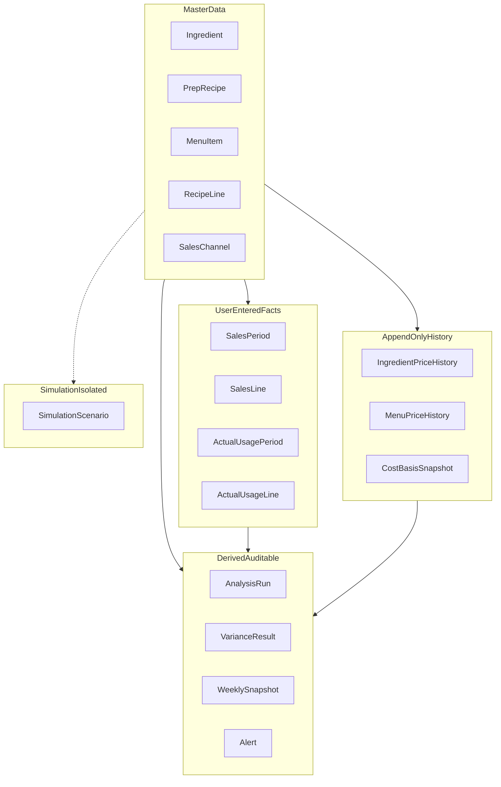
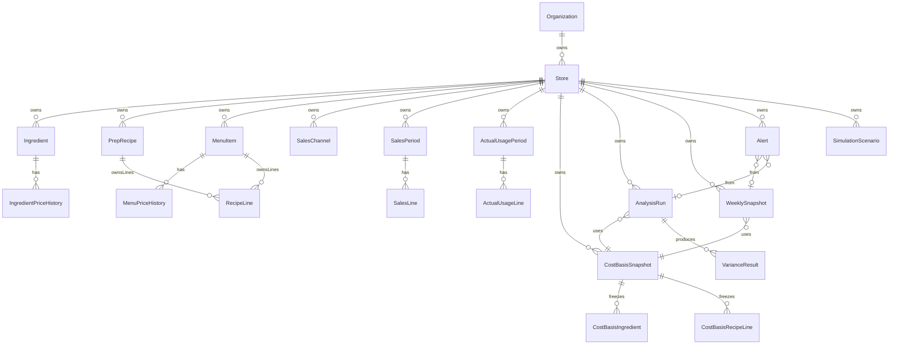

# Stage 1: 데이터 모델 상세 설계

| 항목 | 내용 |
|------|------|
| 기준 | Stage 0 승인 문서 ([05](05-data-model.md), [01](01-product-requirements.md), [07](07-formulas.md)) |
| 목적 | 엔티티 관계·필수 필드·제약·인덱스를 구현 가능한 수준으로 확정 |
| 금지 | 손질 수율, 조리시간·인건비 엔티티/필드 |
| 관련 | [12 API 스키마](12-stage1-api-design.md), [13 수집 가능성](13-data-collectability.md) |

---

## 1. 설계 조건 → 모델 대응

| # | 조건 | 설계 대응 |
|---|------|-----------|
| 1 | 식재료 가격 변경 이력 보존 | `IngredientPriceHistory` append-only. 현재값은 `Ingredient`에 캐시 |
| 2 | 과거 원가 분석이 현재가에 덮어씌워지지 않음 | `CostBasisSnapshot` + 분석 실행 시 단가·레시피 투입량 **동결**. as-of 조회는 history로 재현 |
| 3 | 레시피 소비량 vs 실제 소비량 구분 | 이론은 계산 결과(`AnalysisRun`/`VarianceResult`). 실제만 `ActualUsageLine` |
| 4 | 실제 판매 vs 추정 구분 | `SalesLine.source ∈ {MANUAL, CSV_IMPORT}`만 허용. `ESTIMATED` 없음 |
| 5 | 판매량 없는 메뉴 임의 분석 금지 | 집계·사분면·이론 전개 시 `salesQty` 있는 라인만. 없으면 제외 또는 `DATA_INSUFFICIENT` |
| 6 | 시뮬레이션과 실제 저장 분리 | `SimulationScenario.draft`만. 운영 테이블 미변경. apply는 명시 API |
| 7 | 주간 비교 동일 기준·기간 | ISO 주(`weekStart` 월요일), `WeeklySnapshot.basisVersion`, 동일 채널·동일 지표 정의 |
| 8 | 차이·이상 징후 근거 추적 | `AnalysisRun`, `Alert.evidenceJson`, snapshot FK |
| 9 | 수수료 중복 적용 방지 | 채널당 `channelFeeRate` / `paymentFeeRate` / `deliveryFee*` **각 1회**. 중첩 합산 규칙 고정 |
| 10 | 공헌이익 ≠ 순이익 | 스키마·API에 `netProfit` 없음. 지표명 `contribution` / `contributionMargin`만. 고정비·인건비 미포함 |

---

## 2. 도메인 맵



- **Master:** 지금 운영 중인 정의(현재가·현재 레시피).
- **History/Snapshot:** 과거 재현·감사.
- **Facts:** 사용자/CSV가 넣은 실제 관측(판매·실사용). 추정 금지.
- **Derived:** 결정론적 계산 결과. 원천 Fact/Snapshot을 가리킴.
- **Simulation:** 운영·Fact와 물리적으로 분리된 draft.

---

## 3. ERD (Stage 1 확장)



---

## 4. 엔티티 상세

표기: **PK** / **FK** / **UQ** / **REQ**(필수) / **OPT**

### 4.1 테넌시 (요약)

Stage 0과 동일. MVP: Organization당 Store 1.

| 엔티티 | 핵심 UQ / 인덱스 |
|--------|------------------|
| User | UQ(`email`) |
| OrganizationMember | UQ(`organizationId`,`userId`) |
| Store | IX(`organizationId`), 앱 제약 count≤1 |

---

### 4.2 식재료 및 구매 가격 이력

#### Ingredient

| 필드 | 타입 | 제약 | 설명 |
|------|------|------|------|
| id | UUID | PK | |
| storeId | UUID | FK, REQ | |
| name | String | REQ | |
| baseUnit | Enum | REQ | `G` \| `ML` \| `EA` (MVP 고정 집합) |
| purchaseQty | Decimal(18,6) | REQ, >0 | baseUnit 환산 수량 |
| purchasePrice | Decimal(18,2) | REQ, ≥0 | KRW |
| taxType | Enum | REQ | `TAXABLE` \| `EXEMPT` |
| currentUnitCost | Decimal(18,6) | REQ, ≥0 | 캐시. history의 최신 newUnitCost와 일치 유지 |
| notes | String | OPT | |
| createdAt / updatedAt | DateTime | REQ | |

**금지 필드:** yieldRate, trimLoss, labor*.

**인덱스**

- UQ(`storeId`, `name`)
- IX(`storeId`)

**규칙**

- `currentUnitCost = purchasePrice / purchaseQty` (저장 전 domain 계산).
- 단가·구매가·규격 변경 시 **반드시** history 1행 append 후 current 갱신 (트랜잭션).

#### IngredientPriceHistory (append-only)

| 필드 | 타입 | 제약 | 설명 |
|------|------|------|------|
| id | UUID | PK | |
| ingredientId | UUID | FK, REQ | ON DELETE RESTRICT |
| previousUnitCost | Decimal(18,6) | REQ | |
| newUnitCost | Decimal(18,6) | REQ | |
| previousPurchasePrice | Decimal(18,2) | OPT | |
| newPurchasePrice | Decimal(18,2) | OPT | |
| previousPurchaseQty | Decimal(18,6) | OPT | |
| newPurchaseQty | Decimal(18,6) | OPT | |
| effectiveAt | DateTime | REQ | 효력 시각 (기본=now) |
| recordedAt | DateTime | REQ | 기록 시각 |
| source | Enum | REQ | `MANUAL` \| `CSV_IMPORT` \| `AI_ASSIST_CONFIRMED` |
| createdByUserId | UUID | OPT FK | |

**인덱스:** IX(`ingredientId`, `effectiveAt` DESC)

**불변:** UPDATE/DELETE 금지(운영). 보정은 새 history 행으로만.

**as-of 단가:** `effectiveAt <= T` 인 최신 `newUnitCost`. 없으면 해당 시점 분석 불가.

---

### 4.3 메뉴·레시피·프렙

#### PrepRecipe / MenuItem

Stage 0 필드 유지. 추가:

| 엔티티 | 추가 필드 | 설명 |
|--------|-----------|------|
| PrepRecipe | createdAt | |
| MenuItem | defaultChannelId | OPT FK → SalesChannel. 대시보드 기본 채널 |

**인덱스:** UQ(`storeId`,`name`) 각각.

#### RecipeLine

| 필드 | 타입 | 제약 |
|------|------|------|
| id | UUID | PK |
| ownerType | Enum | REQ: `MENU` \| `PREP` |
| menuItemId | UUID | FK, NULL iff ownerType≠MENU |
| prepRecipeId | UUID | FK, NULL iff ownerType≠PREP |
| componentType | Enum | REQ: `INGREDIENT` \| `PREP` |
| ingredientId | UUID | FK, NULL iff componentType≠INGREDIENT |
| componentPrepId | UUID | FK, NULL iff componentType≠PREP |
| qty | Decimal(18,6) | REQ, >0 |
| unit | Enum | REQ, Ingredient/Prep의 단위와 일치 검증 |

**체크 제약**

- owner: (`menuItemId` IS NOT NULL) XOR (`prepRecipeId` IS NOT NULL)
- component: (`ingredientId` IS NOT NULL) XOR (`componentPrepId` IS NOT NULL)
- `componentPrepId ≠ prepRecipeId` (자기 참조 1단 금지; 순환은 DFS로 앱 금지)

**인덱스:** IX(`menuItemId`), IX(`prepRecipeId`), IX(`ingredientId`), IX(`componentPrepId`)

---

### 4.4 판매 채널·수수료 (조건 9)

#### SalesChannel

| 필드 | 타입 | 제약 | 의미 (중복 방지) |
|------|------|------|------------------|
| id | UUID | PK | |
| storeId | UUID | FK | |
| name | String | REQ | |
| channelFeeRate | Decimal(8,6) | REQ, 0–1 | 플랫폼/중개 수수료 **1회** |
| paymentFeeRate | Decimal(8,6) | REQ, 0–1 | 결제(PG/카드) 수수료 **1회** |
| deliveryFeeRate | Decimal(8,6) | REQ, 0–1 | 판매가 비율 배달비 **1회** |
| deliveryFeeFixed | Decimal(18,2) | REQ, ≥0 | 메뉴 1건당 고정 배달비 **1회** |
| feeBasis | Enum | REQ | `PER_MENU_ITEM` (MVP 고정) |
| isDefault | Boolean | REQ | Store당 default 1개 |
| createdAt / updatedAt | | | |

**수수료 합산 (유일하게 허용되는 식)**

\[
channelCost = P \times (channelFeeRate + paymentFeeRate + deliveryFeeRate) + deliveryFeeFixed
\]

- 동일 성격을 두 필드에 나눠 넣지 않는다 (예: 배달앱 중개를 `channelFeeRate`와 `deliveryFeeRate`에 이중 기입 금지 → UI 가이드 + 검증 경고).
- `MenuChannelPrice`는 **판매가 오버라이드만**. 수수료를 다시 갖지 않는다.
- 시뮬레이션 오버라이드는 채널 필드 **치환**. 기존 요율에 가산하지 않는다.

**인덱스:** UQ(`storeId`,`name`), 부분 UQ: default 채널 Store당 1 (`isDefault=true` WHERE)

#### MenuChannelPrice

| 필드 | 제약 |
|------|------|
| UQ(`menuItemId`,`salesChannelId`) | |
| sellingPrice ≥ 0 | 수수료 필드 없음 |

#### MenuPriceHistory

Stage 0과 동일 + `channelId` OPT (채널별 가격 변경 시).

---

### 4.5 이론상 원가 (저장 전략)

이론 원가는 **Master의 현재 정의로 실시간 계산**하거나, 분석 시 **Snapshot으로 동결**한다.

| 용도 | 방식 |
|------|------|
| 대시보드 “지금” | Ingredient.currentUnitCost + 현재 RecipeLine |
| 기간 차이(A), 주간(E), 감사 | `CostBasisSnapshot` 필수 |

실시간 이론 원가 결과를 DB에 “실제”처럼 쓰지 않는다.

---

### 4.6 CostBasisSnapshot (조건 2·7·8)

기간·주간 분석의 **비교 기준**을 고정한다.

#### CostBasisSnapshot

| 필드 | 타입 | 제약 | 설명 |
|------|------|------|------|
| id | UUID | PK | |
| storeId | UUID | FK | |
| label | String | OPT | |
| basisType | Enum | REQ | `AS_OF` \| `PERIOD_END` \| `WEEKLY` |
| asOfAt | DateTime | REQ | 단가·레시피 기준 시각 |
| periodStart | Date | OPT | PERIOD/WEEK와 함께 |
| periodEnd | Date | OPT | 반개구간 `[start, end)` 권장 |
| weekStart | Date | OPT | ISO 월요일, WEEKLY일 때 REQ |
| channelId | UUID | OPT FK | 수수료·판매가 기준 채널. null=default |
| basisVersion | String | REQ | 공식/규칙 버전 예 `costing-v1` |
| createdAt | DateTime | REQ | |
| createdByRunId | UUID | OPT | AnalysisRun/weekly와 연결 |

**인덱스:** UQ(`storeId`,`weekStart`,`channelId`,`basisVersion`) WHERE weekStart IS NOT NULL  
IX(`storeId`,`asOfAt`)

#### CostBasisIngredient

| 필드 | 설명 |
|------|------|
| snapshotId, ingredientId | UQ 쌍 |
| unitCost | 동결 단가 |
| purchasePrice, purchaseQty | 감사 복사 |

#### CostBasisRecipeLine

| 필드 | 설명 |
|------|------|
| snapshotId | |
| ownerType, menuItemId/prepRecipeId | |
| componentType, ingredientId/componentPrepId | |
| qty, unit | 동결 투입량 |

레시피 변경 후에도 과거 주간·variance는 이 스냅샷으로 재현한다.

---

### 4.7 기간별 판매량 (조건 4·5)

#### SalesPeriod

| 필드 | 제약 |
|------|------|
| storeId, periodStart, periodEnd | REQ. `periodStart < periodEnd` |
| UQ(`storeId`,`periodStart`,`periodEnd`) | 동일 구간 중복 방지 |
| grain | Enum: `DAY` \| `WEEK` \| `CUSTOM` |

#### SalesLine

| 필드 | 타입 | 제약 | 설명 |
|------|------|------|------|
| id | UUID | PK | |
| periodId | UUID | FK | |
| menuItemId | UUID | FK | |
| salesChannelId | UUID | OPT FK | |
| qty | Decimal(18,3) | REQ, >0 | **0·음수 저장 금지**. 미판매 메뉴는 행 자체가 없음 |
| source | Enum | REQ | `MANUAL` \| `CSV_IMPORT` 만 |
| importedFileName | String | OPT | CSV일 때 |
| createdAt | DateTime | REQ | |

**UQ:** (`periodId`,`menuItemId`,`salesChannelId`) — channel null은 별도 처리(Postgres에서는 partial unique 또는 sentinel).

**규칙**

- `source=ESTIMATED` 스키마에 존재하지 않음.
- 분석 쿼리는 SalesLine이 있는 메뉴만 포함.
- qty 없는 메뉴를 평균·추정으로 채우지 않음.

---

### 4.8 실제 소비량·실제 원가 (조건 3)

#### ActualUsagePeriod

SalesPeriod와 동일 구간 규칙. 가능하면 SalesPeriod와 **동일 [start,end)** 를 쓰도록 UI 유도 (강제 FK는 OPT `alignedSalesPeriodId`).

#### ActualUsageLine

| 필드 | 제약 | 설명 |
|------|------|------|
| periodId, ingredientId | UQ | |
| actualQty | OPT, ≥0 | 실제 사용량 |
| actualCost | OPT, ≥0 | 실제 사용 금액 |
| unit | OPT | qty 있을 때 REQ |
| source | REQ | `MANUAL` \| `CSV_IMPORT` |
| CHECK | actualQty IS NOT NULL OR actualCost IS NOT NULL | |

이론은 이 테이블에 넣지 않는다.

---

### 4.9 AnalysisRun · VarianceResult (조건 3·8)

#### AnalysisRun

| 필드 | 설명 |
|------|------|
| id, storeId | |
| type | `VARIANCE` \| `CONTRIBUTION` \| `WEEKLY` \| `PRICE_IMPACT` |
| periodStart, periodEnd | |
| costBasisSnapshotId | FK REQ (해당 타입에 as-of 필요 시) |
| salesPeriodId | OPT FK |
| actualUsagePeriodId | OPT FK |
| status | `COMPLETED` \| `INSUFFICIENT_DATA` \| `FAILED` |
| insufficientReason | OPT |
| evidenceJson | 입력 ID·카운트·제외 메뉴 수 등 |
| createdAt | |

`INSUFFICIENT_DATA`일 때 VarianceResult 행을 **만들지 않거나** 비운다. 가짜 수치 금지.

#### VarianceResult

| 필드 | 설명 |
|------|------|
| analysisRunId, ingredientId | |
| theoQty, theoAmt | 스냅샷 단가·레시피·판매량으로 산출 |
| actualQty, actualCost, actualAmt | Fact |
| varianceQty, varianceAmt, varianceRate | |
| unitCostUsed | 동결 단가 (추적) |

---

### 4.10 가격 시뮬레이션 (조건 6)

#### SimulationScenario

| 필드 | 설명 |
|------|------|
| storeId, name | |
| draft | JSON — 아래 스키마 |
| status | `DRAFT` \| `APPLIED` \| `DISCARDED` |
| appliedAt | OPT — apply 시에만 |
| applyResultJson | OPT — 어떤 history id가 생겼는지 |

**draft JSON (개념)**

```json
{
  "baseChannelId": "uuid",
  "menuPrices": { "menuId": 9500 },
  "ingredientUnitCosts": { "ingredientId": 3.0 },
  "channelFees": {
    "channelId": {
      "channelFeeRate": 0.06,
      "paymentFeeRate": 0.03,
      "deliveryFeeRate": 0,
      "deliveryFeeFixed": 0
    }
  }
}
```

- draft는 Ingredient/MenuItem/SalesChannel을 갱신하지 않음.
- `preview` API는 DB에 scenario를 쓰지 않아도 됨.
- `apply`만 history append + current 갱신 (사용자 확인).

---

### 4.11 주간 이상 징후·알림 (조건 7·8)

#### WeeklySnapshot

| 필드 | 제약 | 설명 |
|------|------|------|
| storeId | | |
| weekStart | Date, ISO Monday | UQ with channel+basisVersion |
| weekEnd | Date | weekStart+7 (반개구간) |
| channelId | FK | 비교 채널 고정 |
| costBasisSnapshotId | FK | 해당 주 동결 기준 |
| priorWeekStart | Date | OPT — 비교 대상 주 |
| priorSnapshotId | FK OPT | 직전 주 스냅샷. 없으면 dataSufficient=false |
| basisVersion | String | 예 `weekly-rules-v1` |
| dataSufficient | Boolean | |
| insufficientReason | String OPT | |
| metricsJson | JSON | 메뉴·재료 지표 (동결 기준 산출물) |
| createdAt | | |

**주간 비교 규칙**

- 두 주 모두 동일 `channelId`, 동일 `basisVersion`, 동일 지표 정의.
- prior가 없거나 metrics 비면 알림 미생성.
- 현재 Master 단가로 과거 주를 재계산해 비교하지 않음 (스냅샷만).

#### Alert

| 필드 | 설명 |
|------|------|
| storeId, weekStart, ruleId | E1–E4 |
| weeklySnapshotId | FK |
| analysisRunId | OPT FK |
| severity | INFO \| WARN |
| title, body | |
| entityType, entityId | MENU \| INGREDIENT |
| evidenceJson | 전주/금주 값, 임계값, 관련 historyId 등 |
| acknowledgedAt | OPT |

**인덱스:** IX(`storeId`,`weekStart`), IX(`storeId`,`acknowledgedAt`) WHERE acknowledgedAt IS NULL

---

## 5. 공헌이익 vs 순이익 (조건 10)

| 지표 | 정의 | DB/API |
|------|------|--------|
| 공헌이익 | P − 식재료원가 − channelCost | `contribution` |
| 공헌이익률 | contribution / P | `contributionMargin` |
| 순이익 | 공헌이익 − 인건비 − 임차 등 | **미구현·필드 없음** |

API 응답·스냅샷 JSON에 `netProfit`, `operatingProfit` 키를 두지 않는다. UI 카피도 “순이익”으로 부르지 않는다.

---

## 6. 인덱스·제약 요약

| 대상 | 제약 |
|------|------|
| Ingredient | UQ(storeId,name); IX price history(ingredientId,effectiveAt DESC) |
| Menu/Prep/Channel | UQ(storeId,name) |
| RecipeLine | owner XOR; component XOR; 순환 앱 가드 |
| SalesLine | source∈{MANUAL,CSV_IMPORT}; qty>0; UQ period+menu+channel |
| ActualUsageLine | qty 또는 cost; source 동일 집합 |
| CostBasisSnapshot | week UQ; 불변 자식 테이블 |
| WeeklySnapshot | UQ(store,weekStart,channelId,basisVersion) |
| SimulationScenario | 운영 FK 갱신 없음 (apply 시에만 간접) |
| 전역 | yield/labor 컬럼 금지 |

---

## 7. Prisma 스케치 (참고, 코드 아님)

구현 착수 시 `schema.prisma`는 본 문서 필드명을 따른다. 아래는 요약 스케치다.

```prisma
// 개념 스케치 — 실행용 아님
model Ingredient {
  id               String   @id @default(uuid())
  storeId          String
  name             String
  baseUnit         BaseUnit
  purchaseQty      Decimal  @db.Decimal(18, 6)
  purchasePrice    Decimal  @db.Decimal(18, 2)
  taxType          TaxType
  currentUnitCost  Decimal  @db.Decimal(18, 6)
  // NO yieldRate, NO labor fields
  priceHistory     IngredientPriceHistory[]
  @@unique([storeId, name])
}

model SalesLine {
  source  SalesSource // MANUAL | CSV_IMPORT only
  qty     Decimal     @db.Decimal(18, 3)
  // NO estimated flag
}

model SimulationScenario {
  draft   Json
  status  SimulationStatus // DRAFT | APPLIED | DISCARDED
}
```

---

## 8. Stage 0 대비 변경점

1. **CostBasisSnapshot** 및 자식 테이블 추가 (과거 원가 덮어쓰기 방지의 핵심).
2. **AnalysisRun / VarianceResult**로 차이 근거 추적.
3. **SalesLine.source / ActualUsageLine.source**로 추정 배제.
4. **SalesChannel.feeBasis** + 수수료 단일 합산식 명문화.
5. **WeeklySnapshot**에 priorSnapshot·basisVersion·channelId 고정.
6. **Alert.evidenceJson** 필수화에 가깝게 정의.
7. 순이익 필드 명시적 배제.

Stage 0 [05-data-model.md](05-data-model.md)의 엔티티는 본 문서가 **상세 확정본**이다. 충돌 시 Stage 1을 우선한다.
